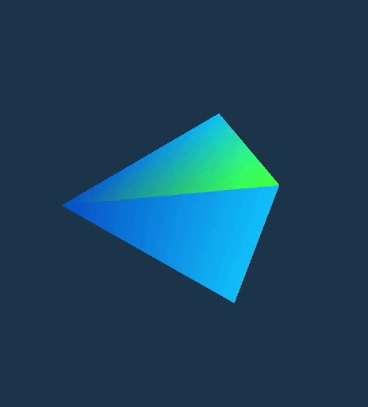
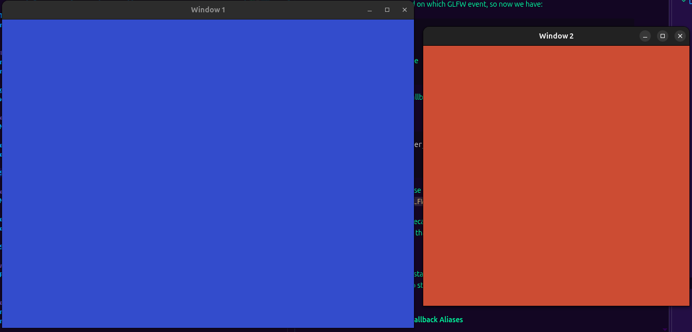
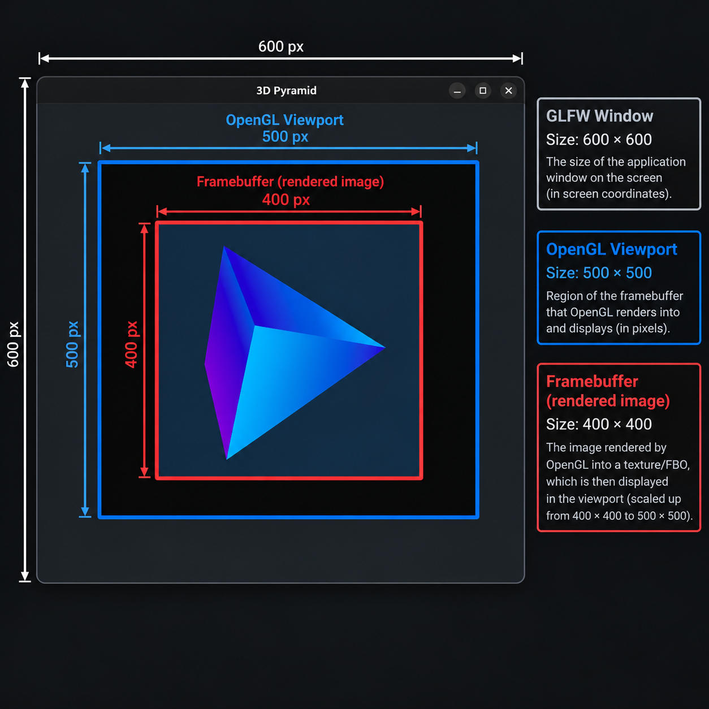
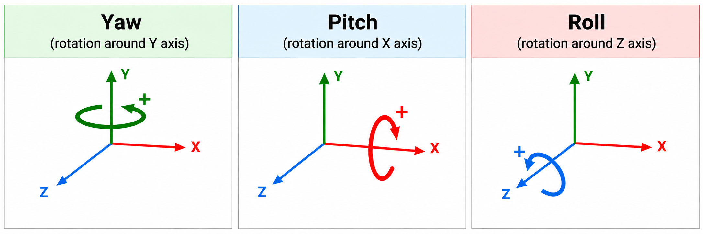

# Lesson 6 - Interactive 3D camera

In the previous lesson, we went from a flat 2D world to a 3D one by constructing and displaying a pyramid. That is really great, because we learned the core concepts of what is needed to "survive" in a world of 3D rendering.

But in this lesson, we will learn how to navigate this 3D world. By navigating, I mean we have to understand how to interact with by changing the camera viewing angles and positions. So the goal of this lesson is simple: learn the concepts needed to controll the camera in order to truly feel the 3D world.

In this lesson we will learn:

- reading mouse button, mouse movement, and keyboard modifier input using GLFW
- tracking mouse movement using the change in X and Y coordinates
- controlling camera yaw and pitch using mouse movement
- rotating the camera around its local up and right axes
- rolling the camera around its local forward axis
- changing the camera's distance from the object using mouse scroll input
- representing and combining camera rotations using quaternions
- using the camera orientation to orbit around our 3D object
- constructing the view matrix from the camera's position and orientation

At the end of this lesson we will be able to control our camera and view our pyramid from all angles like this:



# Contents

0. [Project Structure](#0-project-structure)
1. [Input Handling](#1-input-handling)
2. [Yaw, Pitch, Roll](#2-yaw-pitch-roll)
3. [Mouse Movement Tracking](#3-mouse-movement-tracking)
   - 3.1. [Input Reading](#31-input-reading)
   - 3.2. [Input Processing](#32-input-processing)
     - 3.2.1. [Mouse Input to Camera Rotation](#321-mouse-input-to-camera-rotation)
     - 3.2.2. [Scroll to Camera Zoom](#322-scroll-to-camera-zoom)
4. [Quaternion Rotations](#4-quaternion-rotations)
   - 4.1. [Euler Angles](#41-euler-angles)
   - 4.2. [Gimbal Lock](#42-gimbal-lock)
   - 4.3. [Introducing Quaternions](#43-introducing-quaternions)
   - 4.4. [How Quaternions Work](#46-how-quaternions-work)
   - 4.5. [Quaternions in Our Camera](#45-quaternions-in-our-camera)
5. [Framebuffer and Viewport](#5-framebuffer-and-viewport)


# 0. Project Structure

Before moving any forward I want to say that starting from this lesson, we will not contain all of our code in a single `main.cpp` file. From now on, everything we write, we try to separate into files. I wanted to do the same for lesson 5 already, but at the same time that lesson already had a lot of new and often complex topics to learn, so introducing file tree was not an option (though, to be honest, I feel like if I separated that lesson into different files, maybe t would have been easier to understand).

From now on, we have this structure:

    lesson_name/
    |
    |
    --- include/    (contains all .hpp (header) files)
    |
    |
    --- src/        (contains all .cpp (source) files)

This way, we keep separate application (the whole lesson code) parts in different files which will make the project (lesson code) easier to read and understand.

Another thing to mention, that starting from this lesson, I am not going to talk about every single piece of code section. If I did that, every single leesson's readme would take thousands of lines of explanations. The goal for each lesson moving forward is just to cover main ideas that lesson is about.


## 0.1. File Tree

I am excluding all the non `.hpp` and `.cpp` files.


    lesson_6_interactive_3d_camera/
    ├── include/
    │   ├── application.hpp
    │   ├── camera_orbit_controller.hpp
    │   ├── camera_orbit.hpp
    │   ├── mesh_open_gl.hpp
    │   ├── mesh.hpp
    │   ├── pyramid.hpp
    │   ├── renderer.hpp
    │   ├── shader_program.hpp
    │   ├── shape.hpp
    │   ├── vertex.hpp
    │   └── window.hpp
    ├── src/
    │   ├── application.cpp
    │   ├── camera_orbit_controller.cpp
    │   ├── camera_orbit.cpp
    │   ├── main.cpp
    │   ├── mesh_open_gl.cpp
    │   ├── mesh.cpp
    │   ├── pyramid.cpp
    │   ├── renderer.cpp
    │   ├── shader_program.cpp
    │   ├── shape.cpp
    │   └── window.cpp

I have been taught a rule that every file should contain only single class, or classes that are in the same family, so let's analize what each of the files pairs (`.hpp` and `.cpp` counterparts) are responsible for. I will list files by how easy it is to understand them.

- `vertex`: contains all the basic and necessary information that describes a single vertex, i.e. it's position and it's color. Do not forget that there could be way more attributes that a vertex could like normals, tangents, texture coordinates and etc, but for this lesson, we are only going to use position and color.
- `mesh`: this is one of those fundamental concepts that needs to be understood. Mesh represents object's geometry using vertices and indices which define how an object's surface is constructed from triangles.
- `shape`: contains basic properties that all possible shapes must contain in order to exist. It also contains a mesh member (this is one of those design things you have to think about before moving forward, because mesh does not necesseraly need to be a part of a `Shape` class). In this lesson those features are:
    
    - position
    - rotation
    - scale

- `pyramid`: contains a mathematical definition that defines a geometric pyramid.
- `mesh_open_gl`: contains OpenGL specific attrbutes used to render a mesh.
- `camera_orbit`: contains a mathematical definition and rotation rules of a camera object. The idea is that this class expects rotation degrees input and it ouputs a view matrix.
- `camera_orbit_controller`: the entire goal of this class is to convert user input (according to rules) into camera rotation degrees on all 3 axes.
- `shader_program`: contains a class that loads shaders source code and compiles it into a usable shader program.
- `application`: contains a top level class that initializes and manages the lifetime of the application with all of the necessary resources like pyramid, renderer, window. It also sets up all the callbacks that are needed for camera control.
- `window`: this class contains the functionality needed to initialize and manage GLFW window. Entire lifetime of GLFW window happens in this class. This class also processes wondow events, such as:

    - window size change
    - mouse button press
    - cursor position on GLFW window change
    - mouse scroll change

- `renderer`: manages OpenGL rendering process.

As you can see, compared to lesson 5, it seems that this lesson is way more organized, and that should be the rule we all follow when creating applications. I always say that if possible, separation of concern should be followed (but trust me when I say this that I often stumble on forgetting this rule myself).

A great way to manage you project is to follow [SOLID](https://en.wikipedia.org/wiki/SOLID) principles, especially the "separation of concern" part.

But, even though lesson 6 code looks organized, there are still a lot of classes that do many things instead of a single one (which already breaks the SOLID principles). This is due to the fact, that the goal of this lesson is not to teach you how to write a good code, rather lessons goal is to lay a strong knowledge groundwork so that we could understand how rendering works. Because of it, I cannot spend 10x time writing a perfect code that would do exactly the same as the current one does.


# 1. Input Handling

Before controlling camera we first have to learn how to read input from keyboard and mouse. Do not think about keyboard and mouse for controlling camera only, because with these input devices we can actually control a lot more than you think, for example:

- text input
- tracking which buttons are being pressed
- mouse movement
- scrolling

Great for us that GLFW provides us with the ability to read and enter this vital part that is crucial for an interactive graphical or game engine.

## 1.1. Input Reading 

Notice, that in the previous sentence, I said that "GLFW provides" and not "OpenGL" provides. Do not stumble on this misinterpretation as I once was doing. Input reading has nothing to do with OpenGL. To repeat myself from the first lesson, OpenGL is a graphics library or graphics API, designed to render pixel colors according to set rules, while GLFW is a graphics library framework, designed for handling the window itself. You can think that OpenGL does not understand what a window is, or in, in other way, you can think that it is "blind" towards the window concept.

Since GLFW is the one responsble for the window, it is also responsible for catching the keyboard and mouse events that happen while the window is in active state.


### 1.1.1. Which Window Events Do We Need?

Before moving forward, let's first understand which window events will be needed. I mean if you look at your keyboard, there are many buttons, your mouse also has different buttons, it also has a scroll. Each of these is a separate GLFW window. Also, in order to control the camera, we will need to track the mouse position on the GLFW window. Each (even a tiny) mouse position change is a GLFW window event. Another also, the GLFW window, when we start the application, has a predefined height and width. Most of the applications nowadays provide the ability to change the window size. Guess what, every (even a tiny) window size change is a GLFW event.

So to repeat, for this lesson we will need these events:

- window resize events (framebuffer events)
- cursor position events 
- mouse button press events
- mouse scroll events


### 1.1.2. Input Reading Using GLFW

```C++
// window.hpp
static void framebuffer_size_callback(GLFWwindow* window,
                                      int width,
                                      int height);

static void mouse_button_callback(GLFWwindow* window,
                                  int button,
                                  int action,
                                  int mods);

static void cursor_position_callback(GLFWwindow* window,
                                     double x,
                                     double y);

static void scroll_callback(GLFWwindow* window,
                            double x_offset,
                            double y_offset);

...

// Pointer to the GLFW window object
GLFWwindow* m_window;

// -----------------------------------------------------------------

// window.cpp

// Register GLFW window callables
glfwSetFramebufferSizeCallback(m_window, framebuffer_size_callback);
glfwSetMouseButtonCallback(m_window, mouse_button_callback);
glfwSetCursorPosCallback(m_window, cursor_position_callback);
glfwSetScrollCallback(m_window, scroll_callback);

```

This is how we register window events callbacks using GLFW API. Let's analyze block by block to understand the full picture here.

In the purest form, GLFW constantly tracks events that happen on it's window. Whether it is a mouse position change, window size change or any other event. Even if we did not attach any callbacks, GLFW system still keeps tracking all events. With this functions `glfwSetFramebufferSizeCallback(m_window, framebuffer_size_callback);` and others, we just tell GLFW system that "hey, any event that is a window size change, please call back the the `framebuffer_size_callback`". Analogous is the other callback registering function calls.

               OPERATING SYSTEM
                      |
                      | Event occurs
                      v
               +-------------+
               | GLFW SYSTEM |
               |             |
               | Processes   |
               | the event   |
               +-------------+
                      |
                      v
             Framebuffer resized
                      |
                      v
            Is callback registered?
                      |
                +-----+-----+
                |           |
               YES          NO
                |           |
                v           v
         Invoke callback   No callback
                |          invoked
                v
    framebuffer_size_callback()
                |
                v
        Your code executes

In general, this is how a callback system works. If you attach one, on the next instance of that event your own function will be invoked.


## 1.2. Callback Functions

As you saw earlier, to each of the window event callback set, we had to tell GLFW which specific our function should be called on which GLFW event, so now we have:

```C++
                             Calls
window size change      -------------->     framebuffer_size_callback()
mouse button press      -------------->     mouse_button_callback()
cursor position change  -------------->     cursor_position_callback()
mouse scroll            -------------->     scroll_callback()
```

### 1.2.1. Definitions

First, lets understand each callback function definition and it's signature.

Let's take this example:

```C++
static void framebuffer_size_callback(GLFWwindow* window,
                                      int width,
                                      int height);
```

Why does it have to have these parameters? For me, the thing that I first did not understand was the reason of why was the `GLFWwindow* window` parameter needed.

GLFW `window` is needed, because you have to tell GLFW onto which GLFW window will the callback be registered. Know that a single GLFW application can have multiple GLFW windows.



You can setup callbacks so that different window would have different callbacks.

WHy is `int width` and `int height` needed? The reason is because GLFW system callbacks our function it receives width and height values, so our function also has to have at least these 2 parameters. 

It does not mean that `framebuffer_size_callback` has to have only width and height parameters, it can have as many as you want, but window, width and height (in that specific order) must be included.

Analogous to `framebuffer_size_callback` parameters, our other callback functions have also parameters, that glfw callbacks those functions with.


### 1.2.2. Declaration

Now that we have a callbacks attached to GLFW system, we need to understand what our function definitions of those callbacks look like and why they ar ethe way they are.

Let's analyze them 1 by 1:

```C++
// window.hpp declarations
using FramebufferSizeCallback = std::function<void(int, int)>;

...

static void framebuffer_size_callback(GLFWwindow* window,
                                      int width,
                                      int height);

...

void on_framebuffer_size(int width, int height);

...

int m_framebuffer_width;
int m_framebuffer_height;

FramebufferSizeCallback m_framebuffer_size_callback;

...

GLFWwindow* m_window;


// window.cpp definitions

void Window::on_framebuffer_size(int width,
                                 int height)
{
    m_framebuffer_width = width;
    m_framebuffer_height = height;

    if (m_framebuffer_size_callback)
        m_framebuffer_size_callback(width, height);
}

void Window::framebuffer_size_callback(GLFWwindow* window,
                                       int width,
                                       int height)
{
    Window* self_instance = get_window(window);

    if (self_instance)
        self_instance->on_framebuffer_size(width, height);
}

```

This is what happens when GLFW calbacks our function. I don't know if there is a best approach to explaining this, but I try doing it from the bottom up.

At first we have a definition of `framebuffer_size_callback()` function. As said before, this is the the exact start of how we start processing frambuffer callback. 

What you need to notice is that this function (in the declaration part (`window.hpp`)) is a [static](https://www.geeksforgeeks.org/cpp/static-member-function-in-cpp/). It needs to be `static` because GLFW accepts only static function declarations when registering callbacks.

In the body of `framebuffer_size_callback()`, first, we get a pointer to the window that we registered in the callback, because we want to use the actual window object that we created earlier (do not forget that this function, even though is in `Window` class, but since it is static, it cannot contain any that object specific logic).

```C++
Window* self_instance = get_window(window);
```

After it, an object specific function `on_framebuffer_size()` is called. Notice, that because this is a static function, we have to first get the window object and call this function from the object.

```C++
void Window::on_framebuffer_size(int width,
                                 int height)
{
    m_framebuffer_width = width;
    m_framebuffer_height = height;

    if (m_framebuffer_size_callback)
        m_framebuffer_size_callback(width, height);
}
```

Finally, we reached an object specific member function. This is window specific code that is executed for each window instance created if the framebuffer callback was registered for that instance. 

As you can see, this is also, a very simple function. What we do, we just store the new width and height parameters. There can be many reasons why we want to store window dimensions, one of them being a getter functions for dimensions. For a more complex systems, width and height members can be used for some conditions such as "do this, if window height is this" and etc.

Also, `on_framebuffer_size()` function has a callback in itself.

```C++
if (m_framebuffer_size_callback)
    m_framebuffer_size_callback(width, height);
```

Before answering "why is this callback needed?" question, first, let's understand what `m_framebuffer_size_callback` is.

If you look at the `window.hpp` file and look for `m_framebuffer_size_callback` you can notice that is of type `FramebufferSizeCallback` which in itself is a:

```C++
using FramebufferSizeCallback = std::function<void(int, int)>;
```

[`std::function<...>(...)`](https://www.geeksforgeeks.org/cpp/std-function-in-cpp/) makes function a callable. This allows us to do 1 importatnt thing: it allows us to register another callback to this specific function callable (`m_framebuffer_size_callback`). 

As promised, now we need to understand why we there is a callback attached to `m_framebuffer_size_callback`? Why isn't another callback registered directly to `glfwSetFramebufferSizeCallback(...)`?


### 1.2.3. Callback on Callback

In the `Window` class you can notice that there is 1 additional function:

```C++
// window.hpp
void set_framebuffer_size_callback(FramebufferSizeCallback callback);

// window.cpp
void Window::set_framebuffer_size_callback(FramebufferSizeCallback callback)
{
    m_framebuffer_size_callback = std::move(callback);
}

// renderer.hpp
void set_viewport(int width, int height);

// renderer.cpp
void Renderer::set_viewport(int width, int height)
{
    glViewport(0, 0, width, height);
}

// application.cpp
m_window.set_framebuffer_size_callback(
    [this](int width, int height)
    {
        m_renderer.set_viewport(width, height);
    }
);
```

These 2 functions and an additional statement in the application file are what allow us to control the OpenGL's viewport size according to GLFW window size. In lesson 2 I have said that GLFW window size and OpenGL viewport size are related concepts, but 2 different things. 



Just to remind ourselves, there are 3 varying dimensions that come into play when rendering a scene:

- **GLFW** window defines the size of the application window on your screen.
- **OpenGL viewport** defines the rectangular area of the framebuffer where rendered geometry is mapped on the framebuffer.
- **OpenGL framebuffer** is a rendering target that stores pixels colors data. You can think of framebuffer's size as the resolution of your rendered geometry.

Usually, OpenGL renderes geometry into a framebuffer using a viewport that matches (you can also make it so that it would not match, but that's for another lesson) the framebuffer's dimensions. The resulting image in the default framebuffer is then displayed in the GLFW window.

Read more about OpenGL framebuffers and viewports in the [this section](#framebuffer-and-viewport).

Similar to how we registered a callback for framebuffer resize on GLFW window (here framebuffer is a different buffer than the one in OpenGL), here we are setting a callback to resize a OpenGL viewport when resizing GLFW window.

Why can't we register another callback using `glfwSetFramebufferSizeCallback(...)` function? Well, there are 2 reaons why:

1. `glfwSetFramebufferSizeCallback(...)` requires a window argument and OpenGL, actually a renderer class, has no knowledge about window.
2. Usually, GLFW functionality should be separated from OpenGL functionality, because these 2 things are 2 different concepts and we do not want to couple them tightly together due to project scaling issues. Remember SOLID principles!!!

Because we have a callback inside another callback, our function call scheme looks smth like this:

             GLFW WINDOW RESIZED
                     │
                     ▼
      ┌────────────────────────────────┐
      │ GLFW framebuffer callback      │
      │ glfwSetFramebufferSizeCallback │
      └──────────────┬─────────────────┘
                     │
                     ▼
      ┌──────────────────────────────┐
      │ Window class                 │
      │                              │
      │ m_framebuffer_size_callback  │
      │         (width, height)      │
      └──────────────┬───────────────┘
                     │
                     ▼
      ┌──────────────────────────────┐
      │ Application callback         │
      │                              │
      │ [this](int width, int height)│
      └──────────────┬───────────────┘
                     │
                     ▼
      ┌──────────────────────────────┐
      │ Renderer class               │
      │                              │
      │ set_viewport(width, height)  │
      └──────────────┬───────────────┘
                     │
                     ▼
      ┌─────────────────────────────────┐
      │ OpenGL                          │
      │                                 │
      │ glViewport(0, 0, width, height) │
      └─────────────────────────────────┘

To sum it up why we need to resize a viewport when resizing a GLFW window is because if we could change the size of GLFW window without altering the dimensions of OpenGL viewport accordi gly, you would see a weird rendered view on your GLFW window.

I mean just look at what happens when I comment these lines:

```C++
// // Framebuffer
// m_window.set_framebuffer_size_callback(
//     [this](int width, int height)
//     {
//         m_renderer.set_viewport(width, height);
//     }
// );
```

This is how resizing window should properly work:


And this is what happens when viewport transform is not connected to window resize:


Do you see the difference?


# 2. Yaw, Pitch, Roll

Before understanding how we can rotate camera around an object and how to do it by tracking mouse movements, we first need to understand 3 important concepts in rendering (and actually overall in math and physics). 

These 3 concepts are:

- Yaw
- Pitch
- Roll

Remember how in lesson 5 I have spent entire sections talking about camera rotations? I specifically did not include this terminology, because I wanted you to focus specifically on mathematical part of rotations. Because we understood the mathematical part of rotations (at least I hope that we did), we can be fancy and use these 3 new words.

So what are they? I hope this image will be self explanatory.



From this image, we can understand that:

- **Yaw** is a rotation around the Y axis
- **Pitch** is a rotation around X axis
- **Roll** is a rotation around Z axis

Great, we know their definitions, but we still do not know what is a positive and negative rotation around each axis.


## 2.1. World Space Axes

First of all, let's again understand the axes directions and positive rotations. We have to set the rules to tell what is positive and negative rotation and what is up - down, left - right, forward - backward.

What I like to do for these conventions is follow a pure math. In school we learned that a positive rotation is a counterclockwise if our +X is pointing right and +Y is pointing up. Following this example let's build our axes.

Because the camera is orbiting an object (and not being rotated itself), we have to draw axes from that object's perspective, or rather from a perspective of the origin.

Where is the forward and backward for that object? This is the key rule, according to which we will build all the remaining axes. In lesson 5 we learned that -Z axis is pointing towards the screen when the camera is put at the initial position. Since the camera is looking at the object at the object at the origin it must mean that for that object the +Z forward for it.

So now we can say that for the object at the origin (0, 0, 0), the forward direction would be like looking directly forward.

Ok, now in the world coordinates, what is right and up (+X and +Y axes)? For this configuration we can imagine primary math classes, where we always said that +X is right and +Y is up. So we can apply the same rules for the object at the origin also.

So now, from the point of view of the object at the origin we have these axes and it's configurations:

- +X ---> right
- +Y ---> up
- +Z ---> forward

Great, we have set the rules for the world space. Now how about a camera, how would these coordinates look like from the camera point of view?

When creating camera, a simple rule we can foloow is to put the camera at the model space coords: $(0, 0, +z)$ when we are creating a camera object. Ok, we have a camera position, now what about where the camera looks?

In this lesson, one of the goals is to allow the users to control the camera, Since the object is stationary, with control we are essentially just changing the orbital position of the camera. Since camera is orbiting, it will always look into the same point in space and the best place to at (at least for this lesson) is the origin (where we have our pyramid created).


## 2.2. Positive Rotations

We defind axes, we need to define what are positive rotations. Since the camera is the one that is being rotated around the origin, the positive rotation is defined relative to the origin. 

Now looking back at the original image at the start of this section, you can notice that all of the rotations are considered positive if it is counter clockwise.

You might ask me: "How did you come up with these graphs? Why some axes are positive when they point down?". The reason behind these is the just the way I decided to follow my own convention.

Each of the 3 graphs have 1 thing in commong. The main axis of rotation points towards the screen (forward) and because of it and the way we have set up our 3D world space coords, we have the rotation graphs.

I mean just think about it, if we have an initial position of (0, 0, 0) and look in the +Z direction, then +Y is up and +X is right. When we look directly to +Y, then the X axis is horizontal and Z axis is vertical, where +Z points down. The exact same rules were applied for the pitch and roll graphs.

When I had the 3 graphs set up, I decided that for each of the graph the positive rotation will be counter clockwise.

The main thing is that after we have set up these rules, no matter what happens next in the future, we always have to abide by these rules, otherwise, a weird behavior will happen if we apply rotations with different rules.

Also, you can create your own rules. Whatever makes you feel happy or makes it easier to apply rotations. Just make sure that after designing your rules, do not change them later in the future (I mean do not mix up your rules when developing you rotations calculations and logic).

We now have a basic knowledge about yaw, pitch and roll, now let's understand how to convert user input and window events into an actual camera rotations.


# 3. Mouse Movement Tracking

We have just learnt how GLFW events and callbacks on these events work. Now, we can understand how to track mouse movements. 

In this lesson, we need to track mouse movements in order to control the orbital camera. The goal is to press a mouse button (while the cursor is on the GLFW window) and then move the mouse and see how a camera view angle (actually there are angles (plural), because we are in 3D envitonment) changes. The end goal of a orbital camera rotations can be seen at the top of the lesson, in the first gif.

## 3.1. Input Reading

I will not repeat again how to set up callbacks, instead I will just output a necessary piece of code and draw a scheme showing where is called what and what is the flow from process from when GLFW detects mouse move to when the `CameraOrbitController` class receives the event.

```C++
// window.cpp
glfwSetCursorPosCallback(m_window, cursor_position_callback);

void Window::cursor_position_callback(GLFWwindow* window,
                                      double x,
                                      double y)
{
    Window* self_instance = get_window(window);

    if (self_instance)
        self_instance->on_cursor_position(x, y);
}

void Window::on_cursor_position(double x,
                                double y)
{
    if (m_cursor_position_callback)
        m_cursor_position_callback(x, y);
}

// application.cpp
m_window.set_cursor_position_callback(
    [this](double x, double y)
    {
        const bool is_ctrl_down =
            m_window.is_key_pressed(GLFW_KEY_LEFT_CONTROL) ||
            m_window.is_key_pressed(GLFW_KEY_RIGHT_CONTROL);

        m_camera_controller.on_cursor_position(x,
                                               y,
                                               is_ctrl_down);
    }
);

// camera_orbit_controller.hpp
void on_cursor_position(double x,
                        double y,
                        bool is_ctrl_down);
```

This scheme explains how this piece of code works:

                MOUSE MOVED
                     │
                     ▼
      ┌──────────────────────────────┐
      │ GLFW cursor position callback│
      │                              │
      │ glfwSetCursorPosCallback(...)│
      └──────────────┬───────────────┘
                     │
                     ▼
      ┌──────────────────────────────┐
      │ Window class                 │
      │                              │
      │ cursor_position_callback()   │
      │             │                │
      │             ▼                │
      │ on_cursor_position(x, y)     │
      │             │                │
      │             ▼                │
      │ m_cursor_position_callback   │
      │          (x, y)              │
      └──────────────┬───────────────┘
                     │
                     ▼
      ┌──────────────────────────────┐
      │ Application callback         │
      │                              │
      │ [this](double x, double y)   │
      │                              │
      │ Check CTRL key state         │
      └──────────────┬───────────────┘
                     │
                     ▼
        ┌────────────────────────┐
        │ CameraOrbitController  │
        │                        │
        │ on_cursor_position     │
        │ (x, y, is_ctrl_down)   │
        └────────────────────────┘

This flow is essentially the same as for the framebuffer resize callbacks logic, but the output is a bit different. With these callbacks we want to pass 2 things to a camera orbit controller:

1. x and y coordinates of a cursor on the GLFW window
2. Whether or not the `ctrl` button is pressed

With the knowledge of these 2 things `CameraOrbitController` can transform changing cursor position to a camera rotation around the pyramid. Let's see how this magic happens inside.


## 3.2. Input Processing

### 3.2.1. Mouse Input to Camera Rotation

We need input processing for a simple reason: we want to tell the camera how to rotate around the pyramid given yaw, pitch and roll.

Below is a piece of code, that does this magic, i.e. that transforms x and y position to yaw and pitch:

```
          transformation to
(dx, dy) -----------------------> (yaw, pitch)


                      transformation to
(dx, is_ctrl_down) -----------------------> (roll)
```

```C++
namespace
{
    constexpr float MOUSE_ORBIT_X_SENSITIVITY = 0.005f;
    constexpr float MOUSE_ORBIT_Y_SENSITIVITY = 0.005f;
    constexpr float MOUSE_ROLL_SENSITIVITY = 0.005f;
    constexpr float MOUSE_ZOOM_SENSITIVITY = 0.2f;
}

...

void CameraOrbitController::on_mouse_button(int button, int action)
{
    if (button != GLFW_MOUSE_BUTTON_LEFT)
        return;

    if (action == GLFW_PRESS)
    {
        m_is_left_mouse_down = true;
        m_has_last_mouse_position = false;
    }
    else if (action == GLFW_RELEASE)
    {
        m_is_left_mouse_down = false;
    }
}

void CameraOrbitController::on_cursor_position(double x,
                                               double y,
                                               bool is_ctrl_down)
{
    if (!m_is_left_mouse_down)
        return;

    if (!m_has_last_mouse_position)
    {
        m_last_mouse_x = x;
        m_last_mouse_y = y;
        m_has_last_mouse_position = true;
        return;
    }

    const float dx = static_cast<float>(x - m_last_mouse_x);
    const float dy = static_cast<float>(y - m_last_mouse_y);

    m_last_mouse_x = x;
    m_last_mouse_y = y;

    if (is_ctrl_down)
    {
        m_camera.roll(dx * MOUSE_ROLL_SENSITIVITY);
        return;
    }

    m_camera.orbit(-dx * MOUSE_ORBIT_X_SENSITIVITY,
                   dy * MOUSE_ORBIT_Y_SENSITIVITY);
}
```

Before we start, here you can see another callback function that we have set up exactly the as window size change and mouse movement change. It is `on_mouse_button(...)` function. It is yet another callback that's only goal is to track if the mouse button has been pressed.

We need this functionality, because we only want to rotate the camera when moving mouse if the left button of the mouse is pressed. Of course we can remove this callback, but then it would look weird if the camera would be rotated only with mouse movements itself, thus making the user experience awkward.

The goal of this callback is to tell whether or not the left mouse button is pressed or not. Now let's understand what these 2 functions do combined.

What `on_mouse_button(...)` and `on_cursor_position(...)` and is doing can be summarized by this scheme:

         ┌────────────────────────┐
         │ CameraOrbitController  │
         │                        │
         │ on_cursor_position     │
         │ (x, y, is_ctrl_down)   │
         └────────────────────────┘
                     │
                     ▼
              Left mouse down?
                 /        \
               NO          YES
               │            │
               ▼            ▼
             Return     Last position
                        initialized?
                         /       \
                       NO         YES
                       │           │
                       ▼           ▼
                 Save cursor   Calculate dx, dy
                 position      and update position
                       │           │
                       ▼           ▼
                 Set initialized  CTRL down?
                 to true          /       \
                       │        YES        NO
                       ▼         │          │
                     Return      ▼          ▼
                            ┌──────────┐ ┌──────────┐
                            │ Camera   │ │ Camera   │
                            │ roll()   │ │ orbit()  │
                            └──────────┘ └──────────┘

For now, let's ignore the roll, we will understand it immediately after realizing how yaw and pitch calculation happens.

First of all, as mentioned earlier, we need to only track the mouse movements if the left mouse button is pressed. If it is not pressed - perform no calculations. This is exactly what this does:

```C++
if (button != GLFW_MOUSE_BUTTON_LEFT)
    return;
```

What happens if we press the left mouse button?

```C++
if (action == GLFW_PRESS)
{
    m_is_left_mouse_down = true;
    m_has_last_mouse_position = false;
}
```

Immediately, 2 flags come are set:

- `m_is_left_mouse_down` flag tells our class (`CameraOrbitController`) that GLFW detected a left mouse click. We need it, because we have to have some way of telling our program "Hey, left mouse click was detected. From now process any incoming cursor position change.".
- `m_has_last_mouse_position` flag tells if we have a valid previous cursor position to calculate the movement from. We cannot calculate change in x and y if we did not store the previous mose position. with this flag we indicate that we can start saving mouse position coordinates moving forward.

We pressed a button, and these 2 flags got set, what happens next? If we do not move our mouse accross GLFW window, nothing really happens, because `on_cursor_position(...)` only gets called if GLFW detects mouse movement. What happens if we move mouse?

```C++
if (!m_is_left_mouse_down)
    return;

if (!m_has_last_mouse_position)
{
    m_last_mouse_x = x;
    m_last_mouse_y = y;
    m_has_last_mouse_position = true;
    return;
}
```

We immediately hit a 2 `if` statements. What do both of them do?

The first if: `if (!m_is_left_mouse_down)` checks if the mouse button is pressed. If not, no need to perform any operations, immediately return. We do not need to calculate and waste our performance for events that will not trigger camera rotation.

The second if: `if (!m_has_last_mouse_position)` is what stores the mouse position and, sort of, is the entry point from which we can start to calculate the rotation based on mouse movement. We store mouse `x` and `y` coords and also change the state `m_has_last_mouse_position` to `true` so that for later mouse movement events, we immediately skip this `if` statement and proceed directly to calculation.

```C++
const float dx = static_cast<float>(x - m_last_mouse_x);
const float dy = static_cast<float>(y - m_last_mouse_y);
```

Simple math, store the change in cursor (mouse) position. We know the currecnt `x` and `y`, and we know the previouse values `m_last_mouse_x` and `m_last_mouse_y`.

```C++
m_last_mouse_x = x;
m_last_mouse_y = y;
```

For the aforementioned reasons, we need to store the current coordinates, which are the previous coordinates in the next time, this callback is called.

```C++
if (is_ctrl_down)
{
    m_camera.roll(dx * MOUSE_ROLL_SENSITIVITY);
    return;
}

m_camera.orbit(-dx * MOUSE_ORBIT_X_SENSITIVITY,
                dy * MOUSE_ORBIT_Y_SENSITIVITY);
```

Once we know the change for both coordinates, we can call a camera objct so that internally it could rotate the camera. 

If we look again at the `orbit(float yaw_delta, float pitch_delta)` function, it expects yaw and pitch values. The question is "how do we transform a simple change in `dx`, `dy` and ctrl + `dx` to yaw, pitch, roll?".

The idea is simple. Remember, how the very early webpages had the drag for scrolling? Probobly not, because that happened in the 80s. Imagine, that instead of a mouse scroll, you had to press a mouse button and then drag it either up or down, in order to to see what is up or downin the webpage. Here, we are actually doing the same thing. By dragging our mouse (once the left mouse button is pressed) we are changing the corresponding camera rotation.

The defined rules are as follows:

```
       dx -----> yaw
       dy -----> pitch
ctrl + dx -----> yaw
```

`MOUSE_ORBIT_X_SENSITIVITY`, `MOUSE_ORBIT_Y_SENSITIVITY`, `MOUSE_ROLL_SENSITIVITY` are just 3 constants that let's us control how fast does the change in x or y coordinate affect the rotation value. Later, it is preffered to make these constants controllable by the user.

So that is, essentially, it. We learned to transform the mouse input to an actual camera rotation around the pyramid.


### 3.2.2. Scroll to Camera Zoom

The same exact analogy and processes apply to camera zoom. To sum it up, this graph explicitly tells how we are processing mouse from when the mouse wheel is scrolled, to when the camera zoom activates:

            MOUSE SCROLL WHEEL
                     │
                     ▼
      ┌──────────────────────────────┐
      │ GLFW scroll callback         │
      │                              │
      │ glfwSetScrollCallback(...)   │
      └──────────────┬───────────────┘
                     │
                     ▼
      ┌──────────────────────────────┐
      │ Window class                 │
      │                              │
      │ scroll_callback()            │
      │              │               │
      │              ▼               │
      │ on_scroll(y_offset)          │
      │              │               │
      │              ▼               │
      │ m_scroll_callback            │
      │       (y_offset)             │
      └──────────────┬───────────────┘
                     │
                     ▼
      ┌──────────────────────────────┐
      │ Application callback         │
      │                              │
      │ [this](double y_offset)      │
      │              │               │
      │              ▼               │
      │ m_camera_controller          │
      │   .on_mouse_scroll(y_offset) │
      └──────────────┬───────────────┘
                     │
                     ▼
      ┌──────────────────────────────┐
      │ CameraOrbitController        │
      │                              │
      │ on_mouse_scroll(y_offset)    │
      └──────────────┬───────────────┘
                     │
                     ▼
           Calculate zoom amount
                     │
                     ▼
             -y_offset * 0.2f
                     │
                     ▼
             ┌──────────────┐
             │    Camera    │
             │    zoom()    │
             └──────────────┘


# 4. Quaternion Rotations

The last topic I want to touch in this lesson are the quaternions. Before continuing, let me just say that quaternions are the way when dealing with rotations in 3D environment and many 3D engines use them to avoid weird issues, which we are going to discuss later.

In order to understand what quaternions are, I first suggest to make a little side step, by learning what Euler angles are, because understanding them will allow us unlock the real power of quaternions when dealing with 3D rotations.

## 4.1. Euler Angles

Euler angles - is just a fancy name for usual angles that we use everyday. For example: "roatate 90&deg; to the left", or "raise your head 45&deg; to see what is above" and etc.. 

To be more precise, **euler angles** are a set of 3 numerical values that describe a 3D orientation. Those 3 values are:

- Yaw
- Pitch
- Roll

There is no difference if we express those angles in degrees, or more mathematically natural way, in radians.

Here are a few examples of eurler angles:

$
    (45^\circ, 120^\circ, -90^\circ) - \text{degrees} \\
    (\pi / 4, 3\pi / 5, -\pi) - \text{radians}
$

Just remember that eurler angles describe rotations in **3D** environment, not 2D or 4D or any other dimension.


## 4.2. Gimbal Lock

Since Euler angles are so easy to understand, why is there a need to use anything other than them? Well, judging by the name of this section, I bet you can already guess that Euler angles have a major drawback when dealing with rotations in 3D space.

But how exactly does gimbal lock happen? Let's try to understand it mathematically.

Remember from our previous lesson that we can represent rotations using rotation matrices. Since we have three axes, we also have three corresponding rotation matrices.

**Rotation around the X-axis (Pitch):**

$$
R_x(\theta) =
\begin{bmatrix}
1 & 0 & 0 \\
0 & \cos\theta & -\sin\theta \\
0 & \sin\theta & \cos\theta
\end{bmatrix}
$$

**Rotation around the Y-axis (Yaw):**

$$
R_y(\psi) =
\begin{bmatrix}
\cos\psi & 0 & \sin\psi \\
0 & 1 & 0 \\
-\sin\psi & 0 & \cos\psi
\end{bmatrix}
$$

**Rotation around the Z-axis (Roll):**

$$
R_z(\phi) =
\begin{bmatrix}
\cos\phi & -\sin\phi & 0 \\
\sin\phi & \cos\phi & 0 \\
0 & 0 & 1
\end{bmatrix}
$$

Where:

- $\theta$ (theta) represents pitch (X-axis).
- $\psi$ (psi) represents yaw (Y-axis).
- $\phi$ (phi) represents roll (Z-axis).

To describe the final orientation of our camera, we can combine these three rotations.

Remember that in Lesson 5, we decided to use the following rotation order:

```cpp
rotate_z * rotate_y * rotate_x
```

Mathematically, we can represent this as:

$$
\boxed{R = R_z(\phi)R_y(\psi)R_x(\theta)}
$$

Remember that matrix multiplication is performed from right to left when transforming column vectors. Therefore, our rotations are applied in the following order:

1. **Pitch ($\theta$)** — rotation around the X-axis.
2. **Yaw ($\psi$)** — rotation around the Y-axis.
3. **Roll ($\phi$)** — rotation around the Z-axis.

This is exactly the same rotation order we used in Lesson 5.

Now, let's imagine that we rotate our camera by **90° around the Y-axis**, meaning:

$$
\psi = 90^\circ = \frac{\pi}{2}
$$

We know that:

$$
\cos(90^\circ) = 0
$$

$$
\sin(90^\circ) = 1
$$

Therefore, our yaw rotation matrix becomes:

$$
R_y(90^\circ) =
\begin{bmatrix}
0 & 0 & 1 \\
0 & 1 & 0 \\
-1 & 0 & 0
\end{bmatrix}
$$

Now let's substitute this matrix into our original rotation equation:

$$
R = R_z(\phi)R_y(90^\circ)R_x(\theta)
$$

Remember that our rotation order is X → Y → Z. Therefore, the X-axis rotation is applied first, followed by the Y-axis rotation, and finally the Z-axis rotation.

Since matrix multiplication is associative, we can first combine the X-axis and Y-axis rotations, and then multiply the result by the Z-axis rotation:

$$
R = R_z(\phi)\left[R_y(90^\circ)R_x(\theta)\right]
$$

### Step 1: Multiplying the Y-axis and X-axis rotation matrices

Let's start by multiplying the yaw and pitch matrices:

$$
R_y(90^\circ)R_x(\theta) =
\begin{bmatrix}
0 & 0 & 1 \\
0 & 1 & 0 \\
-1 & 0 & 0
\end{bmatrix}
\begin{bmatrix}
1 & 0 & 0 \\
0 & \cos\theta & -\sin\theta \\
0 & \sin\theta & \cos\theta
\end{bmatrix}
$$

Remember how matrix multiplication works. To calculate a single element of the resulting matrix, we multiply the corresponding row from the first matrix by the corresponding column from the second matrix and add the results together.

For example, to calculate the element in the first row and second column, we take:

- The first row of the Y-axis rotation matrix: $(0, 0, 1)$
- The second column of the X-axis rotation matrix: $(0, \cos\theta, \sin\theta)$

We multiply their corresponding components and add them:

$$
0 \cdot 0 + 0 \cdot \cos\theta + 1 \cdot \sin\theta
$$

Which simplifies to:

$$
\sin\theta
$$

Now let's apply the same process to every element of the resulting matrix.

**First row:**

$$
\begin{aligned}
r_{11} &= 0 \cdot 1 + 0 \cdot 0 + 1 \cdot 0 = 0 \\[6pt]
r_{12} &= 0 \cdot 0 + 0 \cdot \cos\theta + 1 \cdot \sin\theta = \sin\theta \\[6pt]
r_{13} &= 0 \cdot 0 + 0 \cdot (-\sin\theta) + 1 \cdot \cos\theta = \cos\theta
\end{aligned}
$$

**Second row:**

$$
\begin{aligned}
r_{21} &= 0 \cdot 1 + 1 \cdot 0 + 0 \cdot 0 = 0 \\[6pt]
r_{22} &= 0 \cdot 0 + 1 \cdot \cos\theta + 0 \cdot \sin\theta = \cos\theta \\[6pt]
r_{23} &= 0 \cdot 0 + 1 \cdot (-\sin\theta) + 0 \cdot \cos\theta = -\sin\theta
\end{aligned}
$$

**Third row:**

$$
\begin{aligned}
r_{31} &= (-1) \cdot 1 + 0 \cdot 0 + 0 \cdot 0 = -1 \\[6pt]
r_{32} &= (-1) \cdot 0 + 0 \cdot \cos\theta + 0 \cdot \sin\theta = 0 \\[6pt]
r_{33} &= (-1) \cdot 0 + 0 \cdot (-\sin\theta) + 0 \cdot \cos\theta = 0
\end{aligned}
$$

Now we can put all nine calculated elements into a single matrix:

$$
R_y(90^\circ)R_x(\theta) =
\begin{bmatrix}
0 & \sin\theta & \cos\theta \\
0 & \cos\theta & -\sin\theta \\
-1 & 0 & 0
\end{bmatrix}
$$

Great! We have successfully combined our X-axis and Y-axis rotations into a single matrix.

But remember, our original rotation equation also contained the Z-axis rotation:

$$
R = R_z(\phi)R_y(90^\circ)R_x(\theta)
$$

We still need to include it.

### Step 2: Multiplying the result by the Z-axis rotation matrix

Now let's multiply our result by the roll rotation matrix:

$$
R =
\begin{bmatrix}
\cos\phi & -\sin\phi & 0 \\
\sin\phi & \cos\phi & 0 \\
0 & 0 & 1
\end{bmatrix}
\begin{bmatrix}
0 & \sin\theta & \cos\theta \\
0 & \cos\theta & -\sin\theta \\
-1 & 0 & 0
\end{bmatrix}
$$

We follow exactly the same matrix multiplication rules as before.

Let's calculate every element individually.

**First row:**

For the element in the first row and first column:

$$
r_{11} =
\cos\phi \cdot 0
+
(-\sin\phi) \cdot 0
+
0 \cdot (-1)
$$

Therefore:

$$
r_{11} = 0
$$

For the element in the first row and second column:

$$
r_{12} =
\cos\phi \cdot \sin\theta
+
(-\sin\phi) \cdot \cos\theta
+
0 \cdot 0
$$

Therefore:

$$
r_{12} =
\cos\phi\sin\theta
-
\sin\phi\cos\theta
$$

For the element in the first row and third column:

$$
r_{13} =
\cos\phi \cdot \cos\theta
+
(-\sin\phi) \cdot (-\sin\theta)
+
0 \cdot 0
$$

Notice that multiplying two negative values produces a positive value.

Therefore:

$$
r_{13} =
\cos\phi\cos\theta
+
\sin\phi\sin\theta
$$

Our first row is now:

$$
\begin{bmatrix}
0 &
\cos\phi\sin\theta - \sin\phi\cos\theta &
\cos\phi\cos\theta + \sin\phi\sin\theta
\end{bmatrix}
$$

**Second row:**

For the element in the second row and first column:

$$
r_{21} =
\sin\phi \cdot 0
+
\cos\phi \cdot 0
+
0 \cdot (-1)
$$

Therefore:

$$
r_{21} = 0
$$

For the element in the second row and second column:

$$
r_{22} =
\sin\phi \cdot \sin\theta
+
\cos\phi \cdot \cos\theta
+
0 \cdot 0
$$

Therefore:

$$
r_{22} =
\sin\phi\sin\theta
+
\cos\phi\cos\theta
$$

For the element in the second row and third column:

$$
r_{23} =
\sin\phi \cdot \cos\theta
+
\cos\phi \cdot (-\sin\theta)
+
0 \cdot 0
$$

Therefore:

$$
r_{23} =
\sin\phi\cos\theta
-
\cos\phi\sin\theta
$$

Our second row is now:

$$
\begin{bmatrix}
0 &
\sin\phi\sin\theta + \cos\phi\cos\theta &
\sin\phi\cos\theta - \cos\phi\sin\theta
\end{bmatrix}
$$

**Third row:**

For the element in the third row and first column:

$$
r_{31} =
0 \cdot 0
+
0 \cdot 0
+
1 \cdot (-1)
$$

Therefore:

$$
r_{31} = -1
$$

For the element in the third row and second column:

$$
r_{32} =
0 \cdot \sin\theta
+
0 \cdot \cos\theta
+
1 \cdot 0
$$

Therefore:

$$
r_{32} = 0
$$

For the element in the third row and third column:

$$
r_{33} =
0 \cdot \cos\theta
+
0 \cdot (-\sin\theta)
+
1 \cdot 0
$$

Therefore:

$$
r_{33} = 0
$$

Our third row is:

$$
\begin{bmatrix}
-1 & 0 & 0
\end{bmatrix}
$$

Now that we have calculated all nine elements, we can combine them into our final rotation matrix:

$$
R =
\begin{bmatrix}
0 &
\cos\phi\sin\theta - \sin\phi\cos\theta &
\cos\phi\cos\theta + \sin\phi\sin\theta \\

0 &
\sin\phi\sin\theta + \cos\phi\cos\theta &
\sin\phi\cos\theta - \cos\phi\sin\theta \\

-1 & 0 & 0
\end{bmatrix}
$$

At first glance, this matrix might look complicated. However, something interesting happens when we simplify its elements using trigonometric identities.

### Step 3: Simplifying the rotation matrix

Remember the following trigonometric identities:

**Cosine of the difference between two angles:**

$$
\cos(A-B) = \cos A\cos B + \sin A\sin B
$$

**Sine of the difference between two angles:**

$$
\sin(A-B) = \sin A\cos B - \cos A\sin B
$$

We can use these identities to simplify the four elements in our matrix that contain trigonometric expressions.

Let's examine them one by one.

**First row, second column:**

We currently have:

$$
r_{12} =
\cos\phi\sin\theta - \sin\phi\cos\theta
$$

Since multiplication is commutative for scalar values, we can rearrange the terms:

$$
r_{12} =
\sin\theta\cos\phi - \cos\theta\sin\phi
$$

Compare this with our sine identity:

$$
\sin(A-B) = \sin A\cos B - \cos A\sin B
$$

If we substitute:

$$
A = \theta
$$

$$
B = \phi
$$

We get:

$$
\sin(\theta-\phi) =
\sin\theta\cos\phi - \cos\theta\sin\phi
$$

Therefore:

$$
\boxed{r_{12} = \sin(\theta-\phi)}
$$

**First row, third column:**

We currently have:

$$
r_{13} =
\cos\phi\cos\theta + \sin\phi\sin\theta
$$

Rearranging the terms:

$$
r_{13} =
\cos\theta\cos\phi + \sin\theta\sin\phi
$$

Compare this with our cosine identity:

$$
\cos(A-B) = \cos A\cos B + \sin A\sin B
$$

Substituting:

$$
A = \theta
$$

$$
B = \phi
$$

We get:

$$
\cos(\theta-\phi) =
\cos\theta\cos\phi + \sin\theta\sin\phi
$$

Therefore:

$$
\boxed{r_{13} = \cos(\theta-\phi)}
$$

**Second row, second column:**

We currently have:

$$
r_{22} =
\sin\phi\sin\theta + \cos\phi\cos\theta
$$

Rearranging the terms:

$$
r_{22} =
\cos\theta\cos\phi + \sin\theta\sin\phi
$$

This is the same expression we just simplified for $r_{13}$.

Therefore:

$$
\boxed{r_{22} = \cos(\theta-\phi)}
$$

**Second row, third column:**

We currently have:

$$
r_{23} =
\sin\phi\cos\theta - \cos\phi\sin\theta
$$

Rearranging the terms:

$$
r_{23} =
\cos\theta\sin\phi - \sin\theta\cos\phi
$$

Now compare this with:

$$
\sin(\theta-\phi) =
\sin\theta\cos\phi - \cos\theta\sin\phi
$$

Notice that our expression has the opposite signs.

We can factor out a negative sign:

$$
r_{23} =
-\left(
\sin\theta\cos\phi - \cos\theta\sin\phi
\right)
$$

Using our sine identity:

$$
\boxed{r_{23} = -\sin(\theta-\phi)}
$$

### Step 4: Constructing the simplified rotation matrix

Now let's return to our original result:

$$
R =
\begin{bmatrix}
0 &
\cos\phi\sin\theta - \sin\phi\cos\theta &
\cos\phi\cos\theta + \sin\phi\sin\theta \\

0 &
\sin\phi\sin\theta + \cos\phi\cos\theta &
\sin\phi\cos\theta - \cos\phi\sin\theta \\

-1 & 0 & 0
\end{bmatrix}
$$

We have just demonstrated that:

$$
\begin{aligned}
r_{12} &= \sin(\theta-\phi) \\[6pt]
r_{13} &= \cos(\theta-\phi) \\[6pt]
r_{22} &= \cos(\theta-\phi) \\[6pt]
r_{23} &= -\sin(\theta-\phi)
\end{aligned}
$$

Let's substitute these expressions into our rotation matrix.

The result is:

$$
\boxed{
R =
\begin{bmatrix}
0 & \sin(\theta-\phi) & \cos(\theta-\phi) \\
0 & \cos(\theta-\phi) & -\sin(\theta-\phi) \\
-1 & 0 & 0
\end{bmatrix}
}
$$

**Notice something strange?**

Initially, our camera's orientation was represented using three Euler angles:

$$
R = R(\theta,\psi,\phi)
$$

But after setting yaw to 90°, our rotation matrix depends only on the difference between pitch and roll:

$$
\boxed{\theta-\phi}
$$

In other words, the final rotation matrix no longer depends on pitch and roll independently.

This means that different combinations of pitch and roll can produce exactly the same camera orientation.

And that is precisely the problem we call **gimbal lock**.

**Notice something strange?**

Initially, our camera's orientation was described using three angles:

$$
R = R(\theta,\psi,\phi)
$$

But after setting yaw to 90°, our rotation matrix depends only on the difference between pitch and roll:

$$
\boxed{\theta-\phi}
$$

This means that pitch and roll no longer independently affect our camera's orientation.

For example, consider these two configurations:

**Configuration 1:**

- Pitch = 30°
- Yaw = 90°
- Roll = 10°

**Configuration 2:**

- Pitch = 60°
- Yaw = 90°
- Roll = 40°

For the first configuration:

$$
\theta-\phi = 30^\circ-10^\circ = 20^\circ
$$

For the second configuration:

$$
\theta-\phi = 60^\circ-40^\circ = 20^\circ
$$

Both configurations produce exactly the same rotation matrix!

$$
\boxed{
R(30^\circ,90^\circ,10^\circ)
=
R(60^\circ,90^\circ,40^\circ)
}
$$

Here, the arguments follow the order $(\theta,\psi,\phi)$, corresponding to pitch, yaw, and roll.

**This is gimbal lock!**

When yaw reaches 90°, the effective pitch and roll axes become aligned. Because of this, changing pitch and roll no longer produces two independent rotational effects.

Although we still have three rotation angles, our Euler-angle representation has lost one independent degree of freedom at this orientation.

It is important to understand that the camera itself has not physically lost the ability to rotate. Instead, the problem comes from how we represent its orientation using three sequential Euler rotations.

Also, gimbal lock is not limited to positive 90° rotations. With our chosen rotation order, the same problem occurs when yaw reaches -90°.

More generally, the angle at which gimbal lock occurs depends on the rotation order we choose. Since we are using:

$$
R = R_z(\phi)R_y(\psi)R_x(\theta)
$$

the middle rotation is yaw, which is why gimbal lock occurs when yaw reaches $\pm90^\circ$.

This raises an interesting question:

**Can we represent rotations in 3D space without running into this problem?**

Yes! And this is exactly why we are going to introduce **quaternions**.


# 5. Framebuffer and Viewport

In the 1.2.3. section I talked a little bit about GLFW window, OpenGL viewport and OpenGL framebuffer. Here I want to spend a little more time explaining the difference between them, because when finding words to explain their differences I found out that I struggle to do so easily. Because the goal of these lessons is to teach you OpenGL and rendering basics in such a way that even a child could understand I decided that a separate section for this topic is necessary.

I think that explaining GLFW window is not going to be needed here, because you can think about this window the exact same way as any other application you use, that has the ability to be resized. Viewport and framebuffer is a bit different.

As mentioned before, viewport and framebuffer are 2 connected concepts but they cannot be thought as the same thing.

Before continuing I want you to imagine a multiplayer game on a PC or TV where at the same time 4 people can play. Because 4 players play it, there are 4 different camera views, which divide the screen in 4 equal rectangles:

    ┌──────────────────┬──────────────────┐
    │                  │                  │
    │    Camera 1      │    Camera 2      │
    │                  │                  │
    ├──────────────────┼──────────────────┤
    │                  │                  │
    │    Camera 3      │    Camera 4      │
    │                  │                  │
    └──────────────────┴──────────────────┘

As mentioned before:

- **Framebuffer** is a rendering target which stores pixel color values that are ready to be shown on the screen.
- **Viewport** is a rectangular area which specifies where on the framebuffer the rendered geometry should be mapped.

Now imagine these 2 configurations of framebuffer and viewport sizes:

1. Framebuffer - (800, 800), viewport - (400, 400)
2. Framebuffer - (400, 400), viewport - (800, 800)

For the first configuration we would be getting this:

            FRAMEBUFFER (800 × 800)
    ┌──────────────────┬──────────────────┐
    │                  │                  │
    │    Viewport 1    │    Viewport 2    │
    │                  │                  │
    │    400 × 400     │    400 × 400     │
    │                  │                  │
    ├──────────────────┼──────────────────┤
    │                  │                  │
    │    Viewport 3    │    Viewport 4    │
    │                  │                  │
    │    400 × 400     │    400 × 400     │
    │                  │                  │
    └──────────────────┴──────────────────┘

And the code part would look something like this:

```C++
// Top-left
glViewport(0, 400, 400, 400);
draw_camera_1();

// Top-right
glViewport(400, 400, 400, 400);
draw_camera_2();

// Bottom-left
glViewport(0, 0, 400, 400);
draw_camera_3();

// Bottom-right
glViewport(400, 0, 400, 400);
draw_camera_4();
```

Here we have a single framebuffer and 4 different viewports (application can have more than 1 viewport).

In the second configuration, we would have this:

            Viewport (800 × 800)
    ┌──────────────────┬──────────────────┐
    │                  │                  │
    │   Framebuffer 1  │   Framebuffer 2  │
    │                  │                  │
    │    400 × 400     │    400 × 400     │
    │                  │                  │
    ├──────────────────┼──────────────────┤
    │                  │                  │
    │   Framebuffer 3  │   Framebuffer 4  │
    │                  │                  │
    │    400 × 400     │    400 × 400     │
    │                  │                  │
    └──────────────────┴──────────────────┘

Code would looks like this:

```C++
// Framebuffer 1
glBindFramebuffer(GL_FRAMEBUFFER, framebuffer1);
glViewport(0, 0, 400, 400);
glClear(GL_COLOR_BUFFER_BIT | GL_DEPTH_BUFFER_BIT);
draw_camera_1();

// Framebuffer 2
glBindFramebuffer(GL_FRAMEBUFFER, framebuffer2);
glViewport(0, 0, 400, 400);
glClear(GL_COLOR_BUFFER_BIT | GL_DEPTH_BUFFER_BIT);
draw_camera_2();

// Framebuffer 3
glBindFramebuffer(GL_FRAMEBUFFER, framebuffer3);
glViewport(0, 0, 400, 400);
glClear(GL_COLOR_BUFFER_BIT | GL_DEPTH_BUFFER_BIT);
draw_camera_3();

// Framebuffer 4
glBindFramebuffer(GL_FRAMEBUFFER, framebuffer4);
glViewport(0, 0, 400, 400);
glClear(GL_COLOR_BUFFER_BIT | GL_DEPTH_BUFFER_BIT);
draw_camera_4();
```

Do you understand the difference now? 

Not to elaborate any more, but I want you to understand that there isn't single "best choice" that works for all the possible situations. There are cases where a single framebuffer wih multiple viewports is better, as there are also situations where a single viewport with multiple framebuffers is better.

Also, if you have a single framebuffer (if app does not use more than 1) and if your framebuffer has a larger dimension than that viewport, you are essentially wasting memory of your system, because parts of the framebuffer are never used, just like in this example:

        FRAMEBUFFER (800 × 800)
    ┌──────────────────────────────┐
    │                              │
    │                              │
    │                              │
    │                              │
    ├──────────────┐               │
    │              │               │
    │      /\      │               │
    │     /  \     │               │
    │    /____\    │               │
    └──────────────┴───────────────┘
        VIEWPORT
        400 × 400

Just remember that viewport tells where on the framebuffer the rendered geometry should be mapped to. 